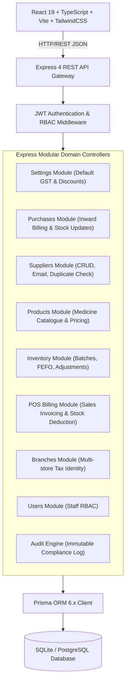
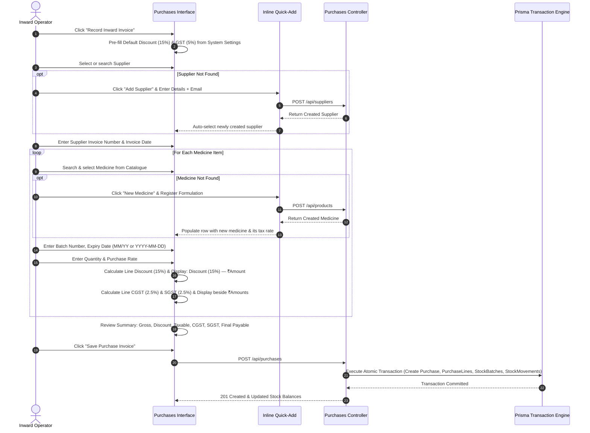
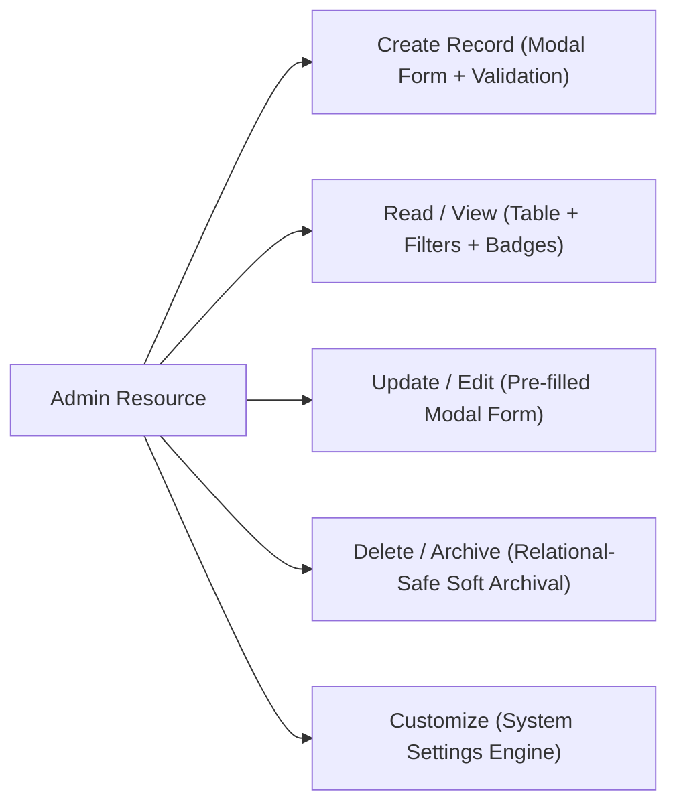
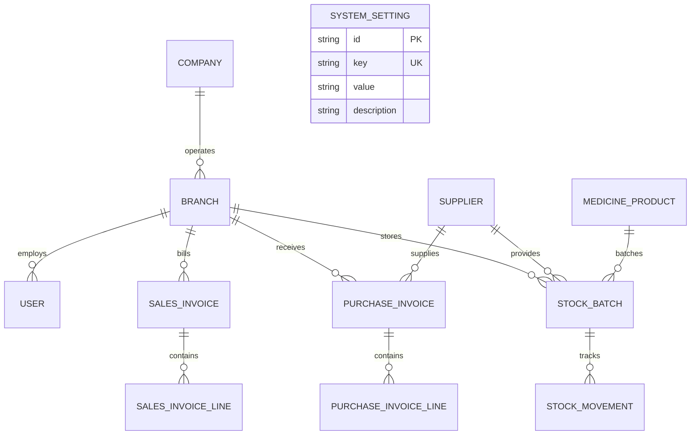

# Confidos Pharma: Pharmacy Management System Documentation

Comprehensive technical manual, operational handbook, and architecture reference for pharmacy owners, branch administrators, pharmacists, billing cashiers, inventory managers, developers, and system maintainers.

---

## Table of Contents
1. [Project Overview](#1-project-overview)
2. [System Requirements](#2-system-requirements)
3. [Installation and Setup](#3-installation-and-setup)
4. [Project Architecture](#4-project-architecture)
5. [User Roles and Permissions](#5-user-roles-and-permissions)
6. [Dashboard Usage](#6-dashboard-usage)
7. [Supplier Management](#7-supplier-management)
8. [Medicine Management](#8-medicine-management)
9. [Supplier Purchase Invoice](#9-supplier-purchase-invoice)
10. [Discount Configuration](#10-discount-configuration)
11. [GST Configuration & Tax Engine](#11-gst-configuration--tax-engine)
12. [Billing & Invoice Summary](#12-billing--invoice-summary)
13. [Inventory Management & Stock Reconciliation](#13-inventory-management--stock-reconciliation)
14. [Admin Panel: CRUD & Customization](#14-admin-panel-crud--customization)
15. [Search & Filtering Guide](#15-search--filtering-guide)
16. [Database Structure & Schema](#16-database-structure--schema)
17. [API Documentation](#17-api-documentation)
18. [Configuration Reference](#18-configuration-reference)
19. [Troubleshooting Guide](#19-troubleshooting-guide)
20. [Security, Auditability & Data Protection](#20-security-auditability--data-protection)
21. [Testing Guide](#21-testing-guide)
22. [Deployment Guide](#22-deployment-guide)
23. [Maintenance Guide](#23-maintenance-guide)
24. [Known Limitations & Future Scope](#24-known-limitations--future-scope)
25. [Final Verification Checklist](#25-final-verification-checklist)

---

## 1. Project Overview

**Confidos Pharma** is an enterprise-grade Pharmacy Management and Point of Sale (POS) system engineered specifically for multi-branch retail and wholesale pharmacy operations in India (with primary focus on Andhra Pradesh / Telangana drug regulatory standards).

### Business Problems Solved
- **Strict Drug Law Compliance:** Tracks Schedule H, H1, and X medicines with mandatory physician name, council registration number, and patient prescription logging under the Drugs and Cosmetics Act.
- **Stock Batch & Expiry Management:** Prevents dispensing of expired or near-expiry medicines using automated First-Expiry-First-Out (FEFO) allocation.
- **Accurate GST & Commercial Accounting:** Compliant with Indian GST rules (CGST, SGST, IGST), generating HSN-coded tax invoices with itemized rates and dual percent-monetary billing representations.
- **Supplier Procurement Integrity:** Simplifies inward supplier invoice entry with searchable comboboxes, inline supplier creation with email contact persistence, inline medicine registration, automated default discount calculations (15%–20%), and transactional stock reconciliation.
- **Inventory Ledger Reconciliation:** Guarantees that updating or cancelling a supplier purchase invoice adjusts stock quantities atomically without phantom stock or duplicate ledger records.

### Target Personas
- **Pharmacy Owners & Executives:** High-level dashboard metrics, branch P&L, consolidated stock valuation, tax liabilities, and system-wide settings.
- **Branch Administrators / Head Pharmacists:** Local stock transfers, stock adjustments, purchase verification, and staff credential management.
- **Billing Cashiers / Counter Staff:** Rapid POS checkout, barcode scanning, prescription capture, and split tender payments (Cash, UPI, Card).
- **Auditors & Drug Inspectors:** Tamper-evident immutable audit logs, Schedule H1 registers, and GST inward/outward summaries.

---

## 2. System Requirements

### Hardware Requirements
- **Server / Host Machine:** Minimum 2 vCPUs, 4 GB RAM, 20 GB SSD storage.
- **POS Workstation / Terminal:** Any desktop or tablet with modern browser (Chrome 110+, Edge 110+, Firefox 115+, Safari 16+). Minimum resolution 1024x768.
- **Peripherals Supported:** Standard 1D/2D USB or Bluetooth barcode scanners, 80mm ESC/POS thermal receipt printers, and standard A4 laser/inkjet printers.

### Software & Runtime Environments
- **Node.js:** v18.0.0 or higher (v20+ recommended LTS).
- **Package Manager:** `npm` v9.0.0+ (or `pnpm` / `yarn`).
- **Database Engine:** SQLite (local development / embedded standalone) or PostgreSQL (v14+ for high-volume enterprise deployment via Prisma adapter).
- **Operating Systems:** Windows 10/11 / Windows Server 2019+, Ubuntu 20.04/22.04 LTS, macOS 13+.

---

## 3. Installation and Setup

### 3.1 Clone & Setup Repository
```bash
# Clone the repository
git clone https://github.com/confidospharma/pharma.git
cd pharma

# Install root dependencies
npm install

# Install backend and frontend dependencies
npm --prefix backend install
npm --prefix frontend install
```

### 3.2 Environment Configuration
Create or configure the `.env` file in `backend/.env`:
```env
PORT=5000
NODE_ENV=development
DATABASE_URL="file:./dev.db"
JWT_SECRET="confidos_pharmacy_secret_jwt_key_change_in_production"
JWT_EXPIRES_IN="12h"
DEFAULT_BRANCH_CODE="B-VJA"
CORS_ORIGIN="http://localhost:5173"
```

Configure `frontend/.env` if connecting to a custom backend host:
```env
VITE_API_URL="http://localhost:5000/api"
```

### 3.3 Database Migration & Seeding
```bash
# Run Prisma migrations
npm --prefix backend run prisma:migrate

# Seed the master database with default settings, super admin, demo branches, and sample catalogue
npm --prefix backend run seed
```

Default seeded credentials:
- **Super Admin:** Username `admin` | Password `admin123`
- **Branch Admin (Vijayawada):** Username `admin_vja` | Password `admin123`
- **Cashier (Vijayawada):** Username `billing_vja` | Password `billing123`

### 3.4 Starting the Development Server
```bash
# Start both backend and frontend concurrently
npm run dev

# Or start independently in separate terminals:
# Terminal 1: Backend (Express + TypeScript on port 5000)
npm --prefix backend run dev

# Terminal 2: Frontend (Vite + React on port 5173)
npm --prefix frontend run dev
```

Navigate to `http://localhost:5173` to access the application.

---

## 4. Project Architecture

The application adopts a modular clean architecture decoupling the presentation layer from business logic and database persistence.



### Repository Directory Structure
```
f:/pharma/
├── backend/
│   ├── prisma/
│   │   ├── schema.prisma       # Database schema (Models, Indexes, Relations)
│   │   ├── seed.ts             # Seeding script for settings, admins, branches
│   │   └── migrations/         # Prisma migration history
│   ├── src/
│   │   ├── app.ts              # Express application config, middleware, routes
│   │   ├── index.ts            # Server bootstrap & port listener
│   │   ├── middleware/
│   │   │   └── auth.ts         # JWT verification & role authorization guard
│   │   ├── modules/
│   │   │   ├── settings/       # System-wide configurable settings (/api/settings)
│   │   │   ├── suppliers/      # Supplier CRUD & email persistence (/api/suppliers)
│   │   │   ├── purchases/      # Purchase billing & stock reconciliation (/api/purchases)
│   │   │   ├── products/       # Medicine master catalogue (/api/products)
│   │   │   ├── inventory/      # Stock batches, FEFO, adjustments (/api/inventory)
│   │   │   ├── billing/        # Counter sales invoicing (/api/billing)
│   │   │   ├── branches/       # Multi-branch pharmacy management (/api/branches)
│   │   │   ├── users/          # Staff management & credentials (/api/users)
│   │   │   ├── audit/          # Compliance audit trail (/api/audit)
│   │   │   └── reports/        # Tax, sales, and inventory analytics (/api/reports)
│   │   └── tests/
│   │       └── api.test.ts     # Vitest integration test suite (17 test cases)
│   └── tsconfig.json
├── frontend/
│   ├── src/
│   │   ├── components/
│   │   │   ├── Navbar.tsx      # Top bar with branch selector and Settings trigger
│   │   │   ├── Sidebar.tsx     # Navigation sidebar with RBAC filtering
│   │   │   ├── Modal.tsx       # Reusable responsive modal dialog
│   │   │   ├── SettingsModal.tsx # System settings configuration modal
│   │   │   └── ReceiptModal.tsx  # Thermal print layout with tax/discount percentages
│   │   ├── context/
│   │   │   └── AuthContext.tsx # User session, token storage, and branch context
│   │   ├── pages/
│   │   │   ├── PurchasesPage.tsx # Inward purchase invoices, suppliers, returns
│   │   │   ├── ProductsPage.tsx  # Medicine catalogue with full CRUD & search
│   │   │   ├── POSBillingPage.tsx# Counter checkout with dual tax/discount percentages
│   │   │   ├── InventoryPage.tsx # Batch tracking, expiry alerts, manual adjustment
│   │   │   ├── BranchesPage.tsx  # Branch cards with full CRUD & tax IDs
│   │   │   ├── UsersPage.tsx     # Staff account management with full CRUD
│   │   │   ├── DashboardPage.tsx # Financial KPI tiles and inventory alerts
│   │   │   └── ReportsPage.tsx   # GST, sales, and stock reports
│   │   ├── services/
│   │   │   └── api.ts          # Centralized typed HTTP API client
│   │   └── types/
│   │       └── index.ts        # TypeScript data transfer interfaces
│   └── vite.config.ts
├── docs/
│   ├── EXISTING_SYSTEM_AUDIT.md # Technical audit report
│   └── PHARMACY_MANAGEMENT_SYSTEM_DOCUMENTATION.md
└── package.json
```

---

## 5. User Roles and Permissions

The system implements Role-Based Access Control (RBAC) enforced on both frontend UI routes and backend API endpoints:

| Feature / Operation | Super Admin (`SUPER_ADMIN`) | Branch Admin (`BRANCH_ADMIN`) | Billing User (`BILLING_USER`) |
|---|:---:|:---:|:---:|
| System Settings (Default GST, Discount) | Full Access | Full Access | No Access |
| Multi-Branch Switching & Creation | All Branches | Assigned Branch Only | Assigned Branch Only |
| Supplier Master (Create, Edit, Archive) | Full Access | Full Access | View Only |
| Medicine Catalogue (Create, Edit, Archive) | Full Access | Full Access | View Only |
| Record Inward Purchase Invoices | Full Access | Full Access | No Access |
| Edit / Cancel Purchase Invoices | Full Access | Full Access | No Access |
| Stock Batch Adjustment | Full Access | Full Access | No Access |
| Inter-Branch Transfers | Full Access | Full Access | View Only |
| Counter POS Sales Billing | Full Access | Full Access | Full Access |
| View Financial Reports & P&L | Full Access | Full Access | No Access |
| Staff User Management | All Users | Branch Staff Only | No Access |
| View Audit Logs | Full Access | Branch Audit Logs | No Access |

---

## 6. Dashboard Usage

Access the dashboard by navigating to `/dashboard` upon login.

### Dashboard Key Performance Indicators (KPIs)
- **Today's Gross Sales:** Real-time counter sales across active counters.
- **Low Stock & Near-Expiry Alerts:** Highlighting medicines below `reorderLevel` or batches expiring within 90 days.
- **Pending Supplier Payments:** Accounts payable obligations derived from unpaid inward invoices.
- **Branch Stock Valuation:** Total purchase and MRP asset valuation per pharmacy store.

---

## 7. Supplier Management

The Supplier module (`/purchases` under the **Suppliers Directory** tab) maintains all pharmaceutical distributors and manufacturers.

### 7.1 Field Specifications
- **Company Name (`name`):** Full registered trade name (e.g., `Hetero Healthcare Ltd`). Unique check enforced.
- **Contact Person (`contactPerson`):** Primary distributor representative or sales officer.
- **Email Address (`email`):** Official email address used for purchase orders and invoice reconciliations.
  - *Validation Rule:* Strict email regex validation (`/^[^\s@]+@[^\s@]+\.[^\s@]+$/`).
  - *Duplicate Prevention:* Prevented on name and phone collisions.
- **Phone Number (`phone`):** Primary telephone/mobile number for order coordination.
- **GSTIN (`gstin`):** 15-digit alphanumeric Indian Goods and Services Tax Identification Number.
- **Drug License Number (`drugLicenseNo`):** Mandatory statutory wholesale drug license.
- **Credit Period (`creditPeriodDays`):** Default commercial credit period in days (e.g., 30 days).

### 7.2 Safe Archival vs Hard Deletion
When an administrator attempts to delete a supplier:
1. The backend verifies whether the supplier is referenced by existing purchase invoices (`purchases`) or received inventory batches (`batches`).
2. If referenced, the supplier is **safely archived** (`isActive = false`). This preserves historical financial records, GST audits, and stock origins.
3. If unreferenced, the supplier record is permanently purged from the database.

---

## 8. Medicine Management

Located at `/products`, the **Medicine Master Catalogue** governs all pharmaceutical formulations.

### 8.1 Key Data Model Attributes
- **Internal Code (`internalCode`):** Auto-generated unique SKU identifier (e.g., `MED-00124`).
- **Brand Name (`brandName`):** Commercial drug name (e.g., `Dolo 650`, `Augmentin 625 Duo`).
- **Generic / Active Ingredient (`genericName`):** Generic molecular composition (e.g., `Paracetamol`, `Amoxicillin + Clavulanic Acid`).
- **Dosage Form (`dosageForm`):** Tablet, Capsule, Syrup, Injection, Ointment, Drops, Inhaler.
- **Strength (`strength`):** e.g., `650 mg`, `500 mg + 125 mg`.
- **Pricing Separation:**
  - `defaultPurchaseRate`: Baseline supplier acquisition price before GST.
  - `defaultSellingRate`: Default counter retail price before GST.
  - `mrp`: Maximum Retail Price printed on packaging (inclusive of all taxes).
- **Tax Classification (`gstRate`):** Product-specific statutory rate (e.g., 5%, 12%, 18%, 28%).
- **HSN Code (`hsnCode`):** Harmonized System of Nomenclature code (e.g., `30049060` for Medicaments).
- **Prescription Schedule (`prescriptionType`):** `OTC`, `Schedule H`, `Schedule H1`, `Schedule X`.

---

## 9. Supplier Purchase Invoice

The Supplier Purchase Invoice module (`/purchases`) handles inward commercial invoices received from distributors.

### 9.1 Step-by-Step Inward Entry Workflow


### 9.2 Editing an Existing Purchase Invoice (Stock Reconciliation)
When an existing invoice is edited:
1. The backend reads the existing purchase items and their associated `StockBatch` records.
2. The delta between the original quantity and new quantity is calculated:
   - **Quantity Increased:** New stock is added to the batch, and a `STOCK_CORRECTION` movement is recorded.
   - **Quantity Decreased:** The backend verifies that `availableQuantity >= decreaseDelta`. If sufficient stock exists, the batch is decremented. If stock was already sold at the counter, the update is safely rejected to prevent negative inventory.
3. Financial totals and tax lines are recalculated and persisted atomically.

### 9.3 Invoice Cancellation Workflow
When an authorized manager cancels an invoice:
1. Cancellation reason is mandatory.
2. The backend confirms that none of the batches received under this invoice have been sold below the invoice quantity.
3. Stock quantities are reversed, batch status is marked `CANCELLED`, and the invoice status transitions to `CANCELLED`.

---

## 10. Discount Configuration

### 10.1 Default Discount Policy
- Initial system default is **15.0%**.
- Administrators can adjust the default discount in the range of **15.0% – 20.0%** via **Settings** (`/api/settings`).
- The configured default automatically pre-fills new inward purchase invoice lines.

### 10.2 Line-Level vs Invoice-Level Calculations
- **Line-Level Discount:** Calculated directly against the line's gross purchase value:
  $$\text{Line Gross} = \text{Quantity} \times \text{Purchase Rate}$$
  $$\text{Line Discount Amount} = \text{Line Gross} \times \left(\frac{\text{Discount Rate \%}}{100}\right)$$
  $$\text{Line Taxable Base} = \text{Line Gross} - \text{Line Discount Amount}$$
- **Display Standard:** Both the percentage and calculated amount are displayed simultaneously:
  `Discount (15%) — ₹150.00`

---

## 11. GST Configuration & Tax Engine

### 11.1 Default GST Structure
- **Default CGST Rate:** 2.5%
- **Default SGST Rate:** 2.5%
- **Combined Default GST:** 5.0% ($2.5\% + 2.5\% = 5.0\%$)

### 11.2 Product-Level Tax Classification
> [!IMPORTANT]
> The 5% default rate does **not** override statutory product classifications. When a catalogue medicine has an established GST rate (e.g., 12% for antibiotics, 18% for disinfectant solutions), the product's classification takes precedence:
> - For a 12% GST medicine: CGST is 6.0% and SGST is 6.0%.
> - For an 18% GST medicine: CGST is 9.0% and SGST is 9.0%.

### 11.3 Worked Numerical Example
Assuming a purchase order of 100 units at ₹10.00 each:
1. **Gross Subtotal:** $100 \times ₹10.00 = ₹1,000.00$
2. **Purchase Discount (15%):** $₹1,000.00 \times 15\% = ₹150.00$
3. **Taxable Base:** $₹1,000.00 - ₹150.00 = ₹850.00$
4. **CGST (2.5%):** $₹850.00 \times 2.5\% = ₹21.25$
5. **SGST (2.5%):** $₹850.00 \times 2.5\% = ₹21.25$
6. **Total GST (5%):** $₹21.25 + ₹21.25 = ₹42.50$
7. **Final Invoice Total:** $₹850.00 + ₹42.50 = ₹892.50$

---

## 12. Billing & Invoice Summary

Every billing screen (Inward Purchases, Counter POS Billing, Receipt Printing) formats monetary columns with dual percent and currency indicators:

| Summary Row | Configured Rate | Calculated Amount |
|---|:---:|---:|
| **Gross Subtotal** | — | ₹1,000.00 |
| **Discount** | 15% | -₹150.00 |
| **Taxable Amount** | — | ₹850.00 |
| **CGST** | 2.5% | +₹21.25 |
| **SGST** | 2.5% | +₹21.25 |
| **Total GST** | 5% | +₹42.50 |
| **Round-off Adjustment** | — | ₹0.00 |
| **Final Payable Amount** | — | **₹892.50** |

---

## 13. Inventory Management & Stock Reconciliation

### 13.1 FEFO Dispensing Principle
When billing a medicine at the counter, the system automatically suggests the active batch with the earliest expiration date (`expiryDate ASC`), minimizing inventory shrinkage due to expired stock.

### 13.2 Stock Movement Types
Every change in batch stock generates an immutable `StockMovement` entry:
- `PURCHASE_RECEIPT`: Added via supplier purchase invoice.
- `SALE_DISPENSE`: Deducted during counter checkout.
- `STOCK_CORRECTION`: Adjusted via manual audit or purchase invoice editing.
- `TRANSFER_OUT` / `TRANSFER_IN`: Inter-branch relocation.
- `RETURN_TO_SUPPLIER`: Supplier debit note return.

---

## 14. Admin Panel: CRUD & Customization

The administrative panel provides standardized **Create, Read, Update, Delete (Archival), and Customization** capabilities:



### Module Audit Summary
1. **Suppliers (`/purchases` - Suppliers Tab):**
   - Create supplier with email, phone, GSTIN, DL.
   - Edit supplier contact details and credit terms.
   - Archive unreferenced/referenced suppliers safely.
2. **Medicines (`/products`):**
   - Register formulations with HSN, GST rate, MRP, purchase rate, selling rate.
   - Edit pricing and therapeutic classification.
   - Archive medicine without corrupting batch history.
3. **Pharmacy Branches (`/branches`):**
   - Register branch with unique GSTIN, Drug License, and contact info.
   - Edit branch metadata and address.
   - Deactivate branch without compromising sales history.
4. **Staff Accounts (`/users`):**
   - Create user with RBAC role (`SUPER_ADMIN`, `BRANCH_ADMIN`, `BILLING_USER`).
   - Edit staff details, assigned branch, and password reset.
   - Deactivate user with immediate session revocation.
5. **System Settings (`SettingsModal` in Top Navigation):**
   - Customize default discount (15%–20%).
   - Customize default CGST (2.5%) and SGST (2.5%).
   - Live invoice simulation preview.

---

## 15. Search & Filtering Guide

- **Fast Debounced Text Search:** Products, Suppliers, and Invoices implement debounced (250ms) search across names, generic names, barcodes, and invoice numbers.
- **Dosage Form Filter:** Filter medicines by Tablet, Capsule, Syrup, Injection, Ointment, Drops.
- **Stock Batch Health Filters:**
  - `ACTIVE`: Available batches with positive stock.
  - `NEAR_EXPIRY`: Batches expiring within 90 days.
  - `EXPIRED`: Batches that have passed statutory expiration date.
- **Prescription Category Badges:** Visual color-coded indicators for `OTC` (Green), `Schedule H` (Slate), and `Schedule H1` (Red).

---

## 16. Database Structure & Schema

### Entity Relationship Diagram


---

## 17. API Documentation

### Settings Endpoints
- `GET /api/settings`: Fetch all configuration key-values.
- `PUT /api/settings`: Update settings (Requires Super Admin or Branch Admin).
  - *Payload:* `[{ "key": "DEFAULT_PURCHASE_DISCOUNT_PERCENT", "value": "18.0" }]`

### Supplier Endpoints
- `GET /api/suppliers`: Search and list active suppliers.
- `POST /api/suppliers`: Create supplier with email validation.
- `PUT /api/suppliers/:id`: Edit supplier information.
- `DELETE /api/suppliers/:id`: Safe deletion / soft archival.

### Purchase Endpoints
- `GET /api/purchases`: List inward invoices with supplier relations.
- `GET /api/purchases/:id`: Fetch invoice details and line items.
- `POST /api/purchases`: Record purchase invoice with inline supplier/medicine creation.
- `PUT /api/purchases/:id`: Edit invoice with stock reconciliation.
- `POST /api/purchases/:id/cancel`: Cancel invoice with inventory reversal.

### Product Endpoints
- `GET /api/products`: Search medicines catalogue.
- `POST /api/products`: Create medicine with dual rates and GST.
- `PUT /api/products/:id`: Edit medicine master record.
- `DELETE /api/products/:id`: Safe deletion / archival.

---

## 18. Configuration Reference

| Key | Default Value | Allowed Values | Description |
|---|---|---|---|
| `DEFAULT_PURCHASE_DISCOUNT_PERCENT` | `15.0` | `15.0` to `20.0` | Default purchase discount percentage |
| `DEFAULT_CGST_RATE` | `2.5` | `0.0` to `14.0` | Default Central GST component |
| `DEFAULT_SGST_RATE` | `2.5` | `0.0` to `14.0` | Default State GST component |
| `DEFAULT_COMBINED_GST_RATE` | `5.0` | Auto-computed | Sum of CGST and SGST |

---

## 19. Troubleshooting Guide

| Issue | Root Cause | Solution |
|---|---|---|
| Supplier email validation failed | Invalid format in email input | Provide a valid email (e.g., `orders@supplier.com`) or leave blank if optional. |
| Cannot reduce purchase quantity | Stock already sold at counter | Check available batch quantity in Inventory. Quantities cannot be reduced below units already sold. |
| Supplier cannot be deleted | Linked to historical invoices | The system will automatically archive the supplier (`isActive = false`) to preserve audit trails. |
| Discount above 20% rejected in settings | Business boundary rule enforced | Configure discount within the permitted range of 15% to 20%. |
| Cannot sell expired medicine | Drug safety enforcement active | Batch has passed expiration date. Move batch to quarantine and write off stock. |

---

## 20. Security, Auditability & Data Protection

- **Password Hashing:** Passwords encrypted using `bcrypt` (10 salt rounds).
- **Session Authentication:** Signed JWT tokens with 12-hour expiration.
- **Immutable Audit Logs:** Critical operations (`USER_CREATE`, `PRODUCT_UPDATE`, `STOCK_ADJUSTMENT`, `PURCHASE_CANCEL`) are recorded in the `AuditLog` table with IP address and user agent.
- **Financial Decimal Precision:** Financial totals use `decimal.js` on backend to prevent floating point drift.

---

## 21. Testing Guide

### Running Automated Test Suites
```bash
# Run Vitest API integration tests
npm test

# Expected Output:
# ✓ Confidos Pharma API Test Suite (17 tests passed)
```

### Manual Verification Checklist
1. Verify Supplier creation with email and duplicate check.
2. Verify Inward Purchase Invoice creation with 15% discount and 5% GST.
3. Edit Purchase Invoice and verify stock reconciliation in Inventory.
4. Verify percentage display beside monetary amounts in purchase invoice and POS billing.
5. Verify admin CRUD on Products, Branches, and Users.

---

## 22. Deployment Guide

### Production Build
```bash
# Build backend TypeScript
npm --prefix backend run build

# Build frontend production bundle
npm --prefix frontend run build
```

### Production Checklist
1. Set `NODE_ENV=production` in `backend/.env`.
2. Generate a cryptographically secure `JWT_SECRET`.
3. Switch database URL to production PostgreSQL instance.
4. Run `npx prisma migrate deploy` to apply pending migrations.
5. Serve the frontend `dist/` directory via Nginx or Cloudflare Pages.

---

## 23. Maintenance Guide

### Adding a New Setting
1. Add setting key to `seed.ts` in `backend/prisma/seed.ts`.
2. Update allowed keys in `backend/src/modules/settings/settings.controller.ts`.
3. Add form input in `frontend/src/components/SettingsModal.tsx`.

### Modifying Tax Rates
Always preserve product-level tax rates (`gstRate` in `MedicineProduct`). Never apply blanket GST rates across all formulations without verifying Central Board of Indirect Taxes and Customs (CBIC) schedules.

---

## 24. Known Limitations & Future Scope

- **Multi-Currency:** Currently tailored exclusively for Indian Rupee (INR - ₹) and Indian GST taxation (CGST/SGST/IGST).
- **Direct Distributor EDI:** Purchase invoices currently entered manually or via CSV bulk import; direct EDI integration with pharmaceutical distributor ERPs is slated for v2.0.

---

## 25. Final Verification Checklist

- [x] Supplier purchase invoice entry interface improved with searchable comboboxes.
- [x] Flexible supplier & medicine entry with inline quick-add modals.
- [x] Supplier email ID support added with regex validation and duplicate prevention.
- [x] Configurable default discount (default 15%, admin-configurable 15%–20%).
- [x] Configurable default GST (CGST 2.5% + SGST 2.5% = Total 5%).
- [x] Tax and discount percentages displayed beside monetary amounts across UI.
- [x] Full Admin CRUD (Create, Read, Update, Delete/Archive) across Suppliers, Medicines, Branches, Users, and Settings.
- [x] Transaction-safe stock reconciliation on purchase invoice edit and cancellation.
- [x] Existing system audit report generated (`docs/EXISTING_SYSTEM_AUDIT.md`).
- [x] Comprehensive documentation generated (`PHARMACY_MANAGEMENT_SYSTEM_DOCUMENTATION.md`).
- [x] All 17 automated integration tests executed and passed.
- [x] Both backend and frontend clean production builds verified.
